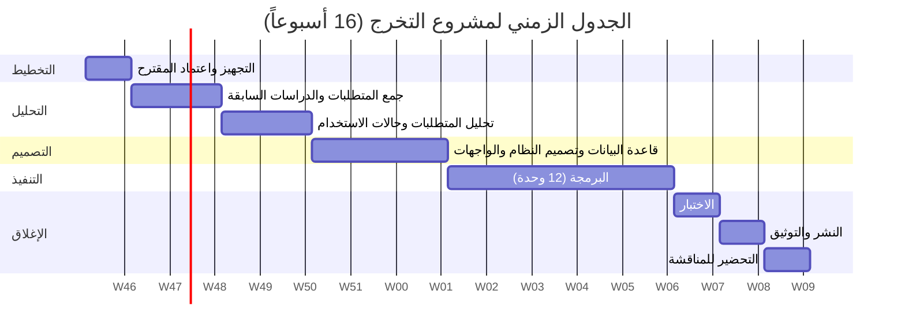

# خارطة الطريق: الخطوات المفترضة لبناء النظام

هذه الوثيقة تجمع **كل المراحل** من الفكرة حتى المناقشة، وتعتمد منهجية **الشلال المعدّل (Iterative Waterfall)** لأنها الأنسب لمشاريع التخرج: متطلبات واضحة ومحددة في المقترح، مع إمكانية الرجوع لمرحلة سابقة عند اكتشاف خطأ.

---

## المرحلة 0: التخطيط والتجهيز (الأسبوع 1)

- [ ] اعتماد المقترح (نموذج رقم 1) من المشرف والقسم.
- [ ] تثبيت الأدوات: Visual Studio 2022 (Community) مع حزمة *.NET desktop development*، و SQL Server Express + SSMS، و Git.
- [ ] إنشاء مستودع Git للمشروع وتنظيم المجلدات (`docs`, `database`, `src`).
- [ ] إعداد جدول زمني ومتابعة أسبوعية مع المشرف.

**المخرجات:** بيئة عمل جاهزة + خطة زمنية.

---

## المرحلة 1: جمع المتطلبات ودراسة النظام الحالي (الأسبوعان 2–3)

- [ ] **دراسة النظام الحالي**: زيارة مكتب عقاري أو مالك عقارات، وتوثيق طريقة العمل الورقية/Excel (نماذج العقود، دفتر الإيصالات، كشوف المتأخرين).
- [ ] **أدوات جمع البيانات**: مقابلة شخصية + استبيان قصير + فحص المستندات (عقد إيجار حقيقي، إيصال قبض).
- [ ] تحديد **مشاكل النظام الحالي** (ضياع العقود، صعوبة معرفة الشواغر، عدم متابعة المتأخرات، انتهاء العقود دون تنبيه).
- [ ] **دراسة الجدوى** (فنية، اقتصادية، تشغيلية) — باختصار.
- [ ] **الدراسات السابقة**: 3–5 أنظمة مشابهة (برامج إدارة أملاك تجارية + مشاريع تخرج سابقة) ومقارنتها بمشروعك في جدول.

**المخرجات:** الفصل الأول والثاني من كتاب المشروع.

---

## المرحلة 2: تحليل المتطلبات (الأسبوعان 4–5)

- [ ] تحديد **الفاعلين** (مدير النظام، الموظف، النظام نفسه كمنبّه).
- [ ] كتابة **المتطلبات الوظيفية** (FR) وغير الوظيفية (NFR) بترقيم واضح.
- [ ] رسم **مخطط حالات الاستخدام** (Use Case Diagram) + وصف نصي لأهم الحالات.
- [ ] تحديد **قواعد العمل** (Business Rules) مثل: لا يُؤجَّر محل لعقدين نشطين في نفس الوقت.
- [ ] رسم **مخطط تدفق البيانات DFD** (المستوى 0 والمستوى 1) — إن طلبه القسم.

**المخرجات:** [`01_Requirements_Analysis.md`](01_Requirements_Analysis.md) ← الفصل الثالث.

---

## المرحلة 3: التصميم (الأسابيع 6–8)

### 3.1 تصميم قاعدة البيانات
- [ ] استخراج الكيانات والعلاقات ← **مخطط ERD**.
- [ ] تحويل ERD إلى **المخطط العلائقي** + **التطبيع حتى 3NF**.
- [ ] **قاموس البيانات** (Data Dictionary): لكل جدول الحقول والأنواع والقيود.
- [ ] كتابة سكربتات SQL وتجربتها.

### 3.2 تصميم النظام
- [ ] اختيار **المعمارية**: ثلاث طبقات (واجهة ← منطق أعمال ← وصول للبيانات).
- [ ] **مخطط الأصناف** (Class Diagram).
- [ ] **مخططات التتابع** (Sequence) لعمليات: تسجيل الدخول، إنشاء عقد، تسجيل دفعة.
- [ ] **مخطط النشاط** (Activity) لدورة حياة العقد.
- [ ] **تصميم الواجهات** (Wireframes/Mockups) لكل شاشة قبل البرمجة.
- [ ] **تصميم التقارير** (شكل كل تقرير وحقوله).

**المخرجات:** [`02_Database_Design.md`](02_Database_Design.md) + [`03_System_Design.md`](03_System_Design.md) ← الفصل الرابع.

---

## المرحلة 4: التنفيذ / البرمجة (الأسابيع 9–13)

نفّذ على شكل **وحدات صغيرة متتالية**، كل وحدة تُختبر قبل الانتقال للتالية:

| الترتيب | الوحدة | يعتمد على |
|---|---|---|
| 1 | قاعدة البيانات (سكربتات + بيانات تجريبية) | — |
| 2 | طبقة الوصول للبيانات `DbHelper` + Models | 1 |
| 3 | شاشة تسجيل الدخول + الصلاحيات | 2 |
| 4 | الشاشة الرئيسية (Dashboard) والقوائم | 3 |
| 5 | إدارة العقارات والوحدات | 2 |
| 6 | إدارة المستأجرين | 2 |
| 7 | إدارة العقود + توليد جدول الأقساط تلقائياً | 5، 6 |
| 8 | تسجيل الدفعات + إيصال القبض | 7 |
| 9 | التنبيهات (المتأخرات + العقود قرب الانتهاء) | 7، 8 |
| 10 | البحث الشامل | 5–8 |
| 11 | التقارير والطباعة + كشف حساب المستأجر | 5–8 |
| 12 | إدارة المستخدمين + الإعدادات + النسخ الاحتياطي | 3 |

**المخرجات:** الكود المصدري ← الفصل الخامس.

---

## المرحلة 5: الاختبار (الأسبوع 14)

- [ ] **اختبار الوحدات** للدوال المهمة (حساب الأقساط، حالة الدفع، التحقق من المدخلات).
- [ ] **اختبار التكامل** (عقد ← أقساط ← دفعات ← تقارير).
- [ ] **اختبار النظام** وفق جدول حالات الاختبار.
- [ ] **اختبار القبول** مع المستخدم الفعلي (المالك/المكتب) وتسجيل ملاحظاته.
- [ ] إصلاح الأخطاء وتوثيقها.

**المخرجات:** [`04_Implementation_Testing.md`](04_Implementation_Testing.md) ← الفصل السادس.

---

## المرحلة 6: النشر والتوثيق (الأسبوع 15)

- [ ] إنشاء **ملف تثبيت** (Setup Project أو Inno Setup) ونقل قاعدة البيانات (Backup/Restore أو سكربت).
- [ ] كتابة **دليل المستخدم** مع صور الشاشات.
- [ ] إكمال كتاب المشروع (الخاتمة، التوصيات، المراجع، الملاحق).

---

## المرحلة 7: التحضير للمناقشة (الأسبوع 16)

- [ ] عرض تقديمي (12–15 شريحة): المشكلة، الأهداف، المنهجية، التحليل، التصميم، لقطات النظام، النتائج، التوصيات.
- [ ] تجهيز **سيناريو عرض حي** ببيانات تجريبية واقعية (سكربت `03_Seed_Data.sql`).
- [ ] تجهيز إجابات لأسئلة متوقعة (لماذا WinForms؟ لماذا SQL Server؟ كيف تحمي كلمات المرور؟ كيف تمنع تأجير وحدة مرتين؟).

---

## ملخص الجدول الزمني

