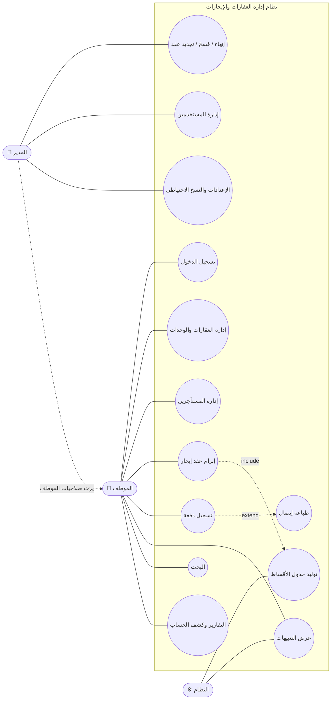
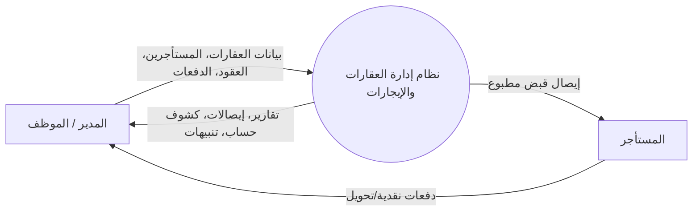

# تحليل المتطلبات

## 1. وصف النظام الحالي ومشاكله

| المشكلة في النظام الحالي (ورقي / Excel) | الحل في النظام المقترح |
|---|---|
| تشتت البيانات في دفاتر وملفات متفرقة وضياع بعض العقود | قاعدة بيانات موحدة (SQL Server) مع نسخ احتياطي |
| صعوبة معرفة الوحدات الشاغرة والمؤجرة | حالة لكل وحدة تتحدث تلقائياً عند إبرام/إنهاء العقد |
| عدم معرفة من دفع ومن تأخر | جدول أقساط آلي لكل عقد + كشف المتأخرات |
| انتهاء العقود دون انتباه | تنبيه تلقائي قبل الانتهاء بعدد أيام قابل للضبط |
| بطء البحث وإعداد الكشوف يدوياً | بحث سريع وتقارير جاهزة للطباعة |
| أي شخص يستطيع تعديل البيانات | صلاحيات مستخدمين (مدير / موظف) |

## 2. الفاعلون (Actors)

| الفاعل | الوصف |
|---|---|
| **المدير (Admin)** | المالك أو مدير المكتب. صلاحيات كاملة: إدارة المستخدمين، الإعدادات، الحذف، إنهاء/فسخ العقود، كل التقارير. |
| **الموظف (Employee)** | يسجّل العقارات والمستأجرين والعقود والدفعات ويبحث ويطبع. لا يحذف ولا يدير المستخدمين. |
| **النظام (System)** | فاعل ثانوي: يولّد الأقساط، ويحدّث حالة المتأخرات، ويعرض التنبيهات عند الدخول. |

## 3. المتطلبات الوظيفية (Functional Requirements)

### 3.1 الدخول والمستخدمين
- **FR-01** تسجيل الدخول باسم مستخدم وكلمة مرور.
- **FR-02** تقييد الشاشات والأزرار حسب دور المستخدم (مدير/موظف).
- **FR-03** إضافة/تعديل/تعطيل المستخدمين (للمدير فقط).
- **FR-04** تغيير كلمة المرور من قبل المستخدم.

### 3.2 العقارات والوحدات
- **FR-05** إضافة/تعديل/حذف عقار (اسم، نوع، مدينة، عنوان، وصف).
- **FR-06** إضافة وحدات للعقار (رقم، نوع، طابق، مساحة، عدد غرف، إيجار افتراضي).
- **FR-07** عرض حالة كل وحدة: شاغرة / مؤجرة / تحت الصيانة.
- **FR-08** منع حذف عقار أو وحدة مرتبطة بعقود.

### 3.3 المستأجرين
- **FR-09** إضافة/تعديل مستأجر (الاسم، الرقم الوطني/جواز، الهواتف، البريد، العنوان).
- **FR-10** منع تكرار الرقم الوطني.
- **FR-11** عرض سجل المستأجر (عقوده السابقة والحالية).

### 3.4 عقود الإيجار
- **FR-12** إبرام عقد يربط **وحدة شاغرة** بمستأجر، مع: تاريخ البداية والنهاية، الإيجار الشهري، دورية الدفع (شهري/ربع سنوي/نصف سنوي/سنوي)، التأمين.
- **FR-13** توليد **جدول الأقساط** تلقائياً عند حفظ العقد.
- **FR-14** تغيير حالة الوحدة إلى "مؤجرة" تلقائياً عند إبرام العقد، وإلى "شاغرة" عند إنهائه.
- **FR-15** إنهاء العقد عند انتهاء مدته، أو فسخه مبكراً (للمدير).
- **FR-16** تجديد العقد (إنشاء عقد جديد بنفس الوحدة والمستأجر بدءاً من اليوم التالي لنهاية القديم).
- **FR-17** طباعة نموذج العقد.

### 3.5 الدفعات
- **FR-18** تسجيل دفعة على قسط معين (كامل أو جزئي) مع: التاريخ، المبلغ، طريقة الدفع (نقداً/تحويل/صك)، رقم إيصال تلقائي.
- **FR-19** تحديث حالة القسط تلقائياً: غير مدفوع / مدفوع جزئياً / مدفوع.
- **FR-20** طباعة **إيصال قبض**.
- **FR-21** منع دفع مبلغ يتجاوز المتبقي على القسط.

### 3.6 التنبيهات
- **FR-22** عرض **الأقساط المتأخرة** (تاريخ استحقاقها مضى ولم تُسدد كاملاً) مع عدد أيام التأخير.
- **FR-23** عرض **العقود التي تنتهي خلال N يوماً** (N قابل للضبط، الافتراضي 30).
- **FR-24** إظهار ملخص التنبيهات في الشاشة الرئيسية فور الدخول.

### 3.7 البحث والتقارير
- **FR-25** بحث سريع بالاسم أو الرقم الوطني أو الهاتف أو رقم العقد أو رقم الوحدة.
- **FR-26** التقارير: (1) العقارات والوحدات وحالتها، (2) الوحدات الشاغرة، (3) العقود النشطة، (4) المتأخرات، (5) العقود قرب الانتهاء، (6) **كشف حساب مستأجر**، (7) الإيرادات المحصلة خلال فترة، (8) إيصال القبض.
- **FR-27** معاينة التقارير قبل الطباعة وتصديرها PDF.

### 3.8 الإعدادات
- **FR-28** ضبط بيانات المكتب (الاسم، الهاتف، العنوان) التي تظهر في رأس التقارير.
- **FR-29** ضبط عدد أيام التنبيه قبل انتهاء العقد.
- **FR-30** أخذ نسخة احتياطية من قاعدة البيانات واستعادتها (للمدير).

## 4. المتطلبات غير الوظيفية (Non-Functional Requirements)

| الرمز | النوع | المتطلب |
|---|---|---|
| NFR-01 | الأمان | تخزين كلمات المرور مشفّرة (Hash + Salt) وليس نصاً صريحاً. |
| NFR-02 | الأمان | استخدام الاستعلامات ذات المعاملات (Parameterized Queries) لمنع SQL Injection. |
| NFR-03 | الأداء | استجابة البحث والتقارير خلال أقل من 2 ثانية لعدد 10,000 سجل. |
| NFR-04 | سهولة الاستخدام | واجهة عربية كاملة من اليمين لليسار (RightToLeft) ورسائل واضحة. |
| NFR-05 | الموثوقية | استخدام المعاملات (Transactions) في العمليات المركبة (العقد + الأقساط) لضمان سلامة البيانات. |
| NFR-06 | التوافق | يعمل على Windows 10 أو أحدث. |
| NFR-07 | قابلية الصيانة | فصل الكود إلى طبقات (واجهة / منطق / بيانات). |
| NFR-08 | سلامة البيانات | قيود على مستوى القاعدة (FK, CHECK, UNIQUE) وليس فقط في الواجهة. |

## 5. قواعد العمل (Business Rules)

- **BR-01** لا يمكن أن يكون للوحدة أكثر من **عقد نشط واحد** في نفس الوقت.
- **BR-02** لا يُبرم عقد إلا على وحدة **شاغرة**.
- **BR-03** تاريخ نهاية العقد يجب أن يكون **بعد** تاريخ البداية.
- **BR-04** قيمة القسط = الإيجار الشهري × عدد أشهر الدورية (1، 3، 6، 12). القسط الأخير يُحسب بالتناسب إذا كانت المدة المتبقية أقل من دورة كاملة.
- **BR-05** القسط **متأخر** إذا كان تاريخ استحقاقه قبل اليوم والمبلغ المدفوع أقل من قيمته.
- **BR-06** مجموع الدفعات على القسط لا يتجاوز قيمته.
- **BR-07** لا يُحذف عقد عليه دفعات؛ يُفسخ فقط.
- **BR-08** الحذف والفسخ وإدارة المستخدمين للمدير فقط.

## 6. مخطط حالات الاستخدام (Use Case Diagram)

> ارسمه في الكتاب باستخدام StarUML أو draw.io. التمثيل التالي يوضح المحتوى:

## 7. الوصف النصي لأهم حالات الاستخدام

### UC4: إبرام عقد إيجار
| البند | الوصف |
|---|---|
| الفاعل | الموظف / المدير |
| الشروط المسبقة | المستخدم مسجّل دخول، توجد وحدة شاغرة، والمستأجر مسجّل. |
| السيناريو الأساسي | 1. يفتح شاشة العقود ويضغط "عقد جديد". 2. يختار العقار ثم الوحدة (تظهر الشاغرة فقط). 3. يختار المستأجر أو يضيف جديداً. 4. يدخل التواريخ والإيجار والدورية والتأمين. 5. يعرض النظام **معاينة جدول الأقساط**. 6. يضغط "حفظ". 7. يحفظ النظام العقد والأقساط ويغيّر حالة الوحدة إلى "مؤجرة" ضمن معاملة واحدة. 8. يعرض رسالة نجاح ورقم العقد. |
| السيناريوهات البديلة | 4أ. تاريخ النهاية قبل البداية ← رسالة خطأ. 7أ. فشل الحفظ ← تراجع كامل (Rollback) ولا يُحفظ شيء. |
| الشروط اللاحقة | عقد نشط + أقساط مولّدة + الوحدة مؤجرة. |

### UC6: تسجيل دفعة
| البند | الوصف |
|---|---|
| الفاعل | الموظف / المدير |
| الشروط المسبقة | يوجد عقد نشط عليه قسط غير مسدد بالكامل. |
| السيناريو الأساسي | 1. يبحث عن المستأجر أو رقم العقد. 2. يعرض النظام الأقساط مع المتبقي لكل قسط. 3. يختار القسط ويدخل المبلغ وطريقة الدفع. 4. يتحقق النظام أن المبلغ ≤ المتبقي. 5. يحفظ الدفعة ويولّد رقم إيصال ويحدّث حالة القسط. 6. يسأل: طباعة الإيصال؟ |
| السيناريوهات البديلة | 4أ. المبلغ أكبر من المتبقي ← رسالة خطأ. |
| الشروط اللاحقة | دفعة مسجلة + حالة القسط محدثة. |

### UC8: عرض التنبيهات
| البند | الوصف |
|---|---|
| الفاعل | النظام (تلقائي) + المستخدم |
| المُحفّز | الدخول للنظام أو فتح الشاشة الرئيسية أو الضغط على "تحديث". |
| السيناريو | 1. يستعلم النظام عن الأقساط المتأخرة والعقود التي تنتهي خلال N يوماً. 2. يعرض عدّادات ملونة (أحمر للمتأخرات، برتقالي للعقود). 3. بالضغط يفتح القائمة التفصيلية مع إمكانية تسجيل دفعة أو تجديد العقد مباشرة. |

## 8. مخطط تدفق البيانات – المستوى 0 (Context Diagram)

