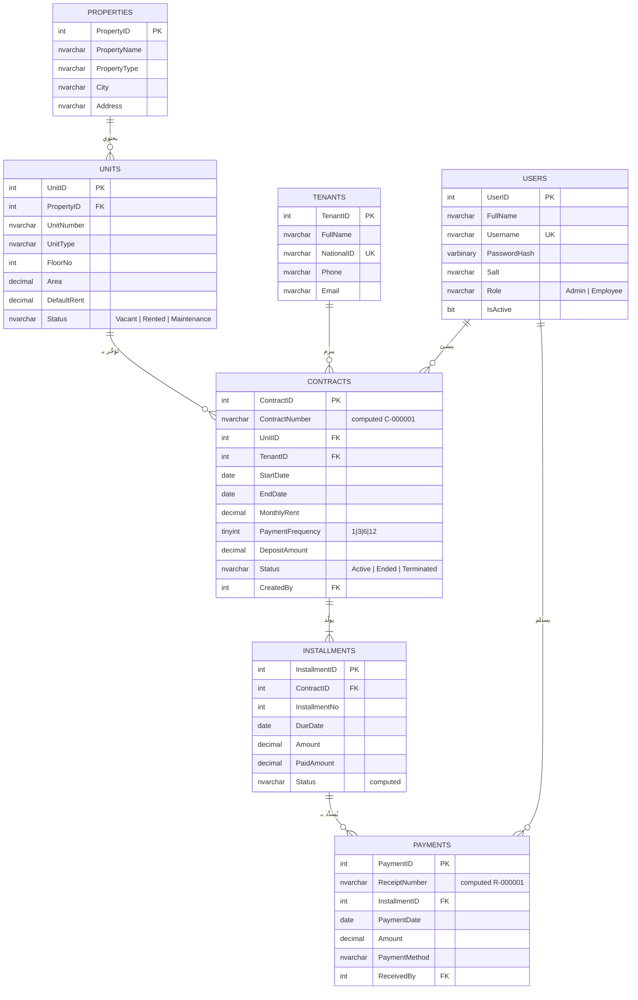

# تصميم قاعدة البيانات

## 1. الكيانات (Entities)

| الكيان | الوصف |
|---|---|
| **User** المستخدم | من يستخدم النظام (مدير / موظف) |
| **Property** العقار | العمارة أو المجمع أو الفيلا |
| **Unit** الوحدة | الجزء القابل للتأجير داخل العقار (شقة، محل، مكتب...) |
| **Tenant** المستأجر | شخص أو جهة تستأجر وحدة |
| **Contract** العقد | يربط وحدة بمستأجر لمدة وقيمة محددة |
| **Installment** القسط | استحقاق مالي ضمن العقد بتاريخ محدد |
| **Payment** الدفعة | مبلغ مستلم فعلاً على قسط (= إيصال قبض) |
| **Settings** الإعدادات | بيانات المكتب وعدد أيام التنبيه |

## 2. العلاقات

| العلاقة | النوع | الشرح |
|---|---|---|
| Property — Unit | 1 : N | العقار يحتوي وحدات متعددة، والوحدة تتبع عقاراً واحداً |
| Unit — Contract | 1 : N | للوحدة عقود متعددة عبر الزمن، **عقد نشط واحد فقط** في الوقت نفسه |
| Tenant — Contract | 1 : N | المستأجر قد يكون له أكثر من عقد |
| Contract — Installment | 1 : N | العقد يولّد أقساطاً متعددة (علاقة اعتماد وجودي – Weak Entity) |
| Installment — Payment | 1 : N | القسط قد يُسدد على دفعات جزئية |
| User — Contract / Payment | 1 : N | لتتبع من أنشأ العقد ومن استلم الدفعة |

## 3. مخطط الكيانات والعلاقات (ERD)

## 4. المخطط العلائقي (Relational Schema)

- **Users** (<u>UserID</u>, FullName, Username, PasswordHash, Salt, Role, IsActive, CreatedAt)
- **Settings** (<u>SettingsID</u>, OfficeName, OfficePhone, OfficeAddress, ContractAlertDays, Currency)
- **Properties** (<u>PropertyID</u>, PropertyName, PropertyType, City, Address, Description, CreatedAt)
- **Units** (<u>UnitID</u>, *PropertyID*, UnitNumber, UnitType, FloorNo, Area, Rooms, DefaultRent, Status, Notes)
- **Tenants** (<u>TenantID</u>, FullName, NationalID, Phone, AltPhone, Email, Address, Notes, CreatedAt)
- **Contracts** (<u>ContractID</u>, ContractNumber, *UnitID*, *TenantID*, StartDate, EndDate, MonthlyRent, PaymentFrequency, DepositAmount, Status, ClosedDate, Notes, *CreatedBy*, CreatedAt)
- **Installments** (<u>InstallmentID</u>, *ContractID*, InstallmentNo, DueDate, Amount, PaidAmount, Status)
- **Payments** (<u>PaymentID</u>, ReceiptNumber, *InstallmentID*, PaymentDate, Amount, PaymentMethod, ReferenceNo, Notes, *ReceivedBy*, CreatedAt)

(المفتاح الأساسي مُسطّر، والمفتاح الأجنبي مائل)

## 5. التطبيع (Normalization)

- **1NF**: كل الحقول ذرية (لا قوائم داخل حقل؛ الهاتف البديل حقل مستقل)، ولكل جدول مفتاح أساسي.
- **2NF**: كل المفاتيح الأساسية بسيطة (IDENTITY) فلا يوجد اعتماد جزئي.
- **3NF**: لا توجد اعتمادات متعدية؛ مثلاً اسم العقار لا يُكرر في جدول العقود بل يُجلب عبر `Units.PropertyID`، واسم المستأجر لا يُخزّن في الدفعات.
- **استثناءات مقصودة (Controlled Denormalization)** موثقة ومبررة:
  - `Installments.PaidAmount`: قيمة مشتقة من مجموع `Payments`، تُحدَّث **حصرياً** داخل الإجراء `sp_RecordPayment` ضمن معاملة، لتسريع كشف المتأخرات والتنبيهات.
  - `Units.Status`: يمكن اشتقاقها من وجود عقد نشط، لكن تُخزن لدعم حالة "تحت الصيانة" ولسرعة الفلترة.
  - `ContractNumber` و `ReceiptNumber` و `Installments.Status`: أعمدة محسوبة (Computed) لا تُدخل يدوياً فلا يمكن أن تتعارض.

## 6. قاموس البيانات (Data Dictionary) – مثال لجدول العقود

| الحقل | النوع | القيد | الوصف |
|---|---|---|---|
| ContractID | INT IDENTITY | PK | المعرف الداخلي |
| ContractNumber | NVARCHAR (محسوب) | PERSISTED | رقم العقد للعرض `C-000001` |
| UnitID | INT | FK → Units, NOT NULL | الوحدة المؤجرة |
| TenantID | INT | FK → Tenants, NOT NULL | المستأجر |
| StartDate | DATE | NOT NULL | بداية العقد |
| EndDate | DATE | NOT NULL, CHECK > StartDate | نهاية العقد |
| MonthlyRent | DECIMAL(12,2) | CHECK > 0 | الإيجار الشهري |
| PaymentFrequency | TINYINT | CHECK IN (1,3,6,12) | دورية الدفع بالأشهر |
| DepositAmount | DECIMAL(12,2) | DEFAULT 0, CHECK ≥ 0 | مبلغ التأمين |
| Status | NVARCHAR(20) | CHECK IN (Active, Ended, Terminated) | حالة العقد |
| ClosedDate | DATE | NULL | تاريخ الإنهاء/الفسخ الفعلي |
| CreatedBy | INT | FK → Users | من أنشأ العقد |

> أكمل جداول قاموس البيانات لباقي الجداول بنفس الشكل في كتاب المشروع (المعلومات كلها موجودة في `database/01_Schema.sql`).

## 7. القيود التي تطبق قواعد العمل على مستوى القاعدة

| قاعدة العمل | طريقة التطبيق في SQL Server |
|---|---|
| BR-01 عقد نشط واحد للوحدة | فهرس فريد مرشّح `UX_Contracts_OneActivePerUnit ... WHERE Status='Active'` |
| BR-02 العقد على وحدة شاغرة فقط | فحص داخل `sp_CreateContract` مع قفل `UPDLOCK` |
| BR-03 النهاية بعد البداية | `CK_Contracts_Dates` |
| BR-04 حساب الأقساط | حلقة التوليد داخل `sp_CreateContract` |
| BR-05 تعريف المتأخر | العرض `vw_OverdueInstallments` |
| BR-06 عدم تجاوز قيمة القسط | `CK_Installments_Paid` + فحص في `sp_RecordPayment` |
| BR-07 عدم حذف عقد عليه دفعات | المفاتيح الأجنبية بدون CASCADE تمنع الحذف تلقائياً |
| عدم تكرار الرقم الوطني | `UQ_Tenants_NationalID` |
| عدم تكرار رقم الوحدة داخل نفس العقار | `UQ_Units_Property_Number` |

## 8. العروض والإجراءات المخزنة

| الكائن | الغرض | المتطلب |
|---|---|---|
| `vw_UnitOccupancy` | الوحدات وحالتها والمستأجر الحالي | FR-07, تقرير 1، 2 |
| `vw_ContractDetails` | العقد مع الإجمالي والمدفوع والرصيد والأيام المتبقية | تقرير 3 |
| `vw_OverdueInstallments` | الأقساط المتأخرة وعدد أيام التأخير | FR-22, تقرير 4 |
| `vw_ExpiringContracts` | العقود قرب الانتهاء حسب الإعدادات | FR-23, تقرير 5 |
| `vw_TenantStatement` | حركات مدين/دائن لكشف الحساب | تقرير 6 |
| `sp_CreateContract` | عقد + أقساط + تحديث الوحدة في معاملة واحدة | FR-12..14 |
| `sp_RecordPayment` | دفعة + تحديث القسط | FR-18..21 |
| `sp_CloseContract` | إنهاء أو فسخ عقد وتحرير الوحدة | FR-15 |
| `sp_RenewContract` | تجديد العقد | FR-16 |
| `sp_DashboardSummary` | أرقام الشاشة الرئيسية | FR-24 |
| `sp_GlobalSearch` | البحث الشامل | FR-25 |
| `sp_RevenueReport` | الإيرادات المحصلة خلال فترة | تقرير 7 |

## 9. مثال على توليد الأقساط

عقد: البداية `2026-01-01`، النهاية `2026-12-31`، الإيجار الشهري 800، الدورية ربع سنوية (3):

| رقم القسط | تاريخ الاستحقاق | المبلغ |
|---|---|---|
| 1 | 2026-01-01 | 2400 |
| 2 | 2026-04-01 | 2400 |
| 3 | 2026-07-01 | 2400 |
| 4 | 2026-10-01 | 2400 |
