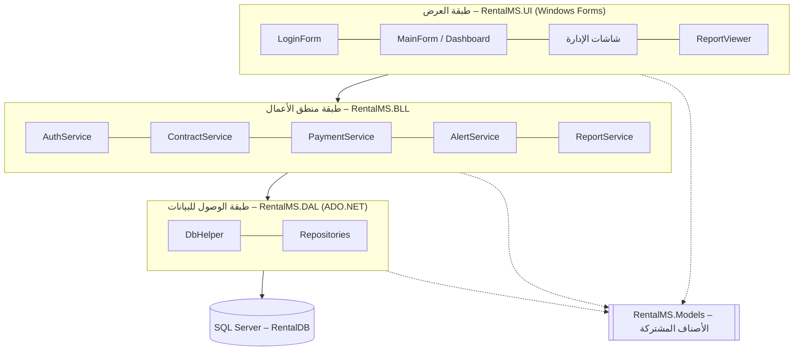
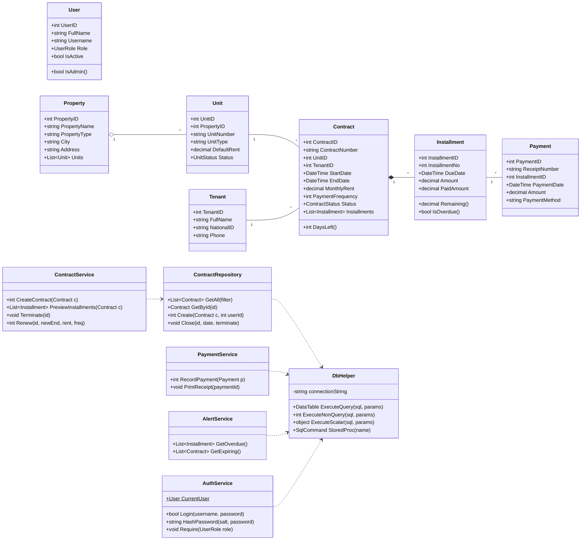
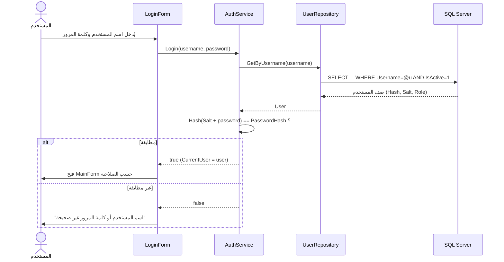
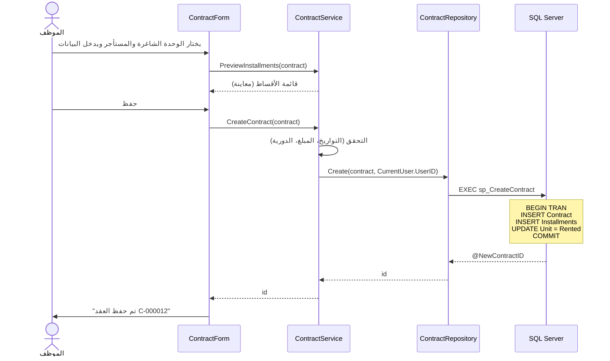
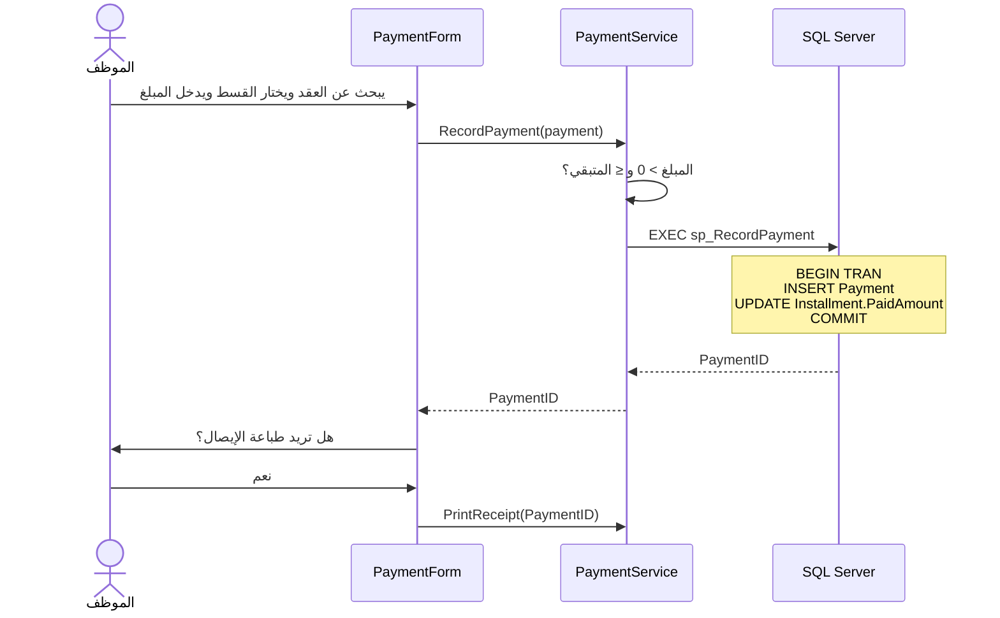
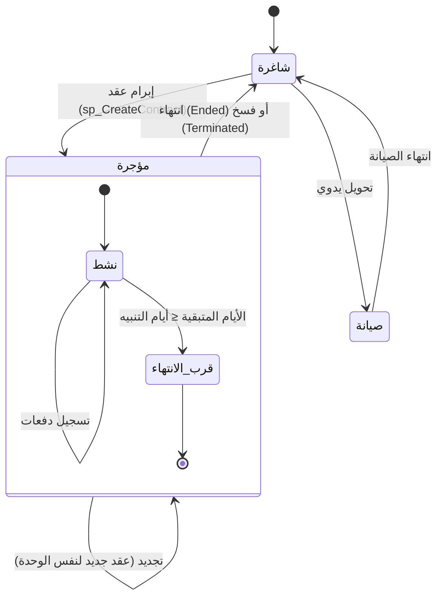
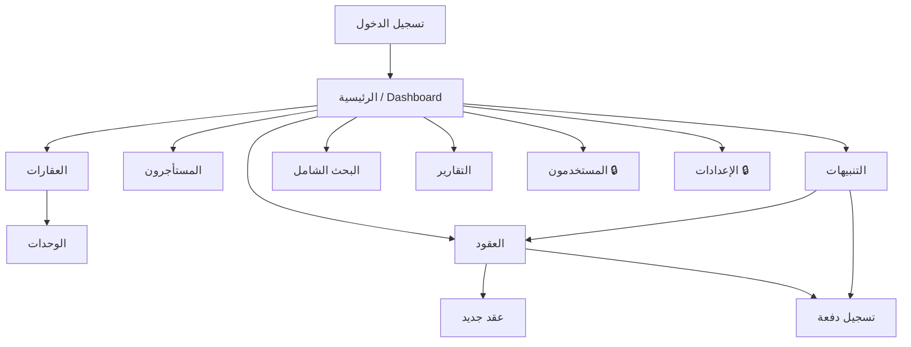

# تصميم النظام

## 1. المعمارية: ثلاث طبقات (3-Tier / Layered Architecture)



**لماذا ثلاث طبقات؟** فصل الواجهة عن المنطق عن البيانات يسهّل الاختبار والصيانة، ويمكّن مستقبلاً من استبدال WinForms بواجهة ويب دون إعادة كتابة المنطق (يُذكر في التوصيات).

| الطبقة | المسؤولية | لا يُسمح لها بـ |
|---|---|---|
| UI | عرض البيانات، استقبال المدخلات، رسائل المستخدم | كتابة SQL مباشرة |
| BLL | التحقق من المدخلات، قواعد العمل، الصلاحيات | التعامل مع عناصر الواجهة (TextBox...) |
| DAL | فتح الاتصال، تنفيذ الاستعلامات والإجراءات، تحويل النتائج إلى كائنات | منطق الأعمال |

## 2. مخطط الأصناف (Class Diagram)



## 3. مخططات التتابع (Sequence Diagrams)

### 3.1 تسجيل الدخول


### 3.2 إبرام عقد


### 3.3 تسجيل دفعة


## 4. مخطط النشاط: دورة حياة العقد (Activity / State)



## 5. تصميم الشاشات (Screens)

> القاعدة العامة: كل النماذج `RightToLeft = Yes` و `RightToLeftLayout = true`، خط **Segoe UI** أو **Tahoma** بحجم 10–11، ألوان هادئة موحدة، وأزرار ثابتة المكان (إضافة / تعديل / حذف / حفظ / إلغاء).

| # | الشاشة | المحتوى الرئيسي | الصلاحية |
|---|---|---|---|
| 1 | **تسجيل الدخول** | اسم المستخدم، كلمة المرور، زر دخول | الجميع |
| 2 | **الرئيسية (Dashboard)** | بطاقات: عدد العقارات، الوحدات المؤجرة/الشاغرة، العقود النشطة، **المتأخرات (أحمر)**، **عقود قرب الانتهاء (برتقالي)**، المحصّل هذا الشهر + قائمة جانبية/شريط قوائم | الجميع |
| 3 | **العقارات** | DataGridView للعقارات + نموذج إدخال + زر "الوحدات" | الجميع (الحذف للمدير) |
| 4 | **الوحدات** | فلترة حسب العقار والحالة، تلوين الصفوف حسب الحالة | الجميع |
| 5 | **المستأجرون** | بحث، نموذج إدخال، تبويب "العقود" لعرض سجله | الجميع |
| 6 | **عقد جديد** | اختيار عقار ← وحدة شاغرة ← مستأجر، التواريخ، الإيجار، الدورية، التأمين، **جدول معاينة الأقساط** | الجميع |
| 7 | **العقود** | قائمة مع فلترة بالحالة، أزرار: عرض، طباعة، تجديد، إنهاء، فسخ | الإنهاء/الفسخ للمدير |
| 8 | **تسجيل دفعة** | بحث بالعقد/المستأجر ← أقساط بالمتبقي ← المبلغ والطريقة ← حفظ وطباعة إيصال | الجميع |
| 9 | **التنبيهات** | تبويبان: المتأخرات / العقود قرب الانتهاء، مع زر "تسجيل دفعة" و"تجديد" مباشرة | الجميع |
| 10 | **البحث الشامل** | مربع بحث واحد ونتائج مصنفة (مستأجر / عقد / وحدة) بالنقر المزدوج تفتح التفاصيل | الجميع |
| 11 | **التقارير** | قائمة التقارير + معايير (فترة، عقار، مستأجر) + معاينة وطباعة وتصدير PDF | الجميع |
| 12 | **المستخدمون** | إضافة، تعديل، تعطيل، إعادة تعيين كلمة المرور | المدير |
| 13 | **الإعدادات** | بيانات المكتب، أيام التنبيه، نسخ احتياطي/استعادة | المدير |

### مخطط تنقل الشاشات


### رسم تقريبي (Wireframe) للشاشة الرئيسية
```
┌──────────────────────────────────────────────────────────────────┐
│  نظام إدارة العقارات والإيجارات        المستخدم: أحمد (مدير) [خروج] │
├───────────────┬──────────────────────────────────────────────────┤
│ 🏠 الرئيسية    │ ┌────────┐ ┌────────┐ ┌────────┐ ┌────────┐      │
│ 🏢 العقارات    │ │العقارات │ │ مؤجرة  │ │ شاغرة  │ │عقود نشطة│     │
│ 🚪 الوحدات     │ │   3    │ │   4    │ │   4    │ │   4    │      │
│ 👥 المستأجرون  │ └────────┘ └────────┘ └────────┘ └────────┘      │
│ 📄 العقود      │ ┌─────────────────┐ ┌──────────────────┐         │
│ 💵 الدفعات     │ │ 🔴 متأخرات: 5    │ │ 🟠 تنتهي قريباً: 1 │          │
│ 🔔 التنبيهات   │ │  3,100 د.ل       │ │                  │          │
│ 🔍 البحث       │ └─────────────────┘ └──────────────────┘         │
│ 📊 التقارير    │  آخر المتأخرات:                                   │
│ ⚙️ الإعدادات   │  ┌─────────────────────────────────────────────┐ │
│               │  │ المستأجر │ الوحدة │ الاستحقاق │ المتبقي │ أيام│ │
│               │  └─────────────────────────────────────────────┘ │
└───────────────┴──────────────────────────────────────────────────┘
```

## 6. مصفوفة الصلاحيات

| الوظيفة | المدير | الموظف |
|---|:---:|:---:|
| عرض/إضافة/تعديل العقارات والوحدات والمستأجرين | ✅ | ✅ |
| حذف العقارات والوحدات والمستأجرين | ✅ | ❌ |
| إبرام عقد / تسجيل دفعة / طباعة إيصال | ✅ | ✅ |
| إنهاء / فسخ / تجديد عقد | ✅ | ❌ |
| التنبيهات والبحث والتقارير | ✅ | ✅ |
| إدارة المستخدمين | ✅ | ❌ |
| الإعدادات والنسخ الاحتياطي | ✅ | ❌ |

**التطبيق**: في الواجهة بإخفاء/تعطيل الأزرار حسب `AuthService.CurrentUser.Role`، **وفي BLL** بفحص `AuthService.Require(UserRole.Admin)` قبل العمليات الحساسة (حماية مزدوجة).

## 7. تصميم التقارير

| # | التقرير | الحقول | المعايير | المصدر |
|---|---|---|---|---|
| 1 | العقارات والوحدات | العقار، الوحدة، النوع، المساحة، الحالة، المستأجر الحالي | العقار | `vw_UnitOccupancy` |
| 2 | الوحدات الشاغرة | العقار، الوحدة، النوع، الإيجار الافتراضي | العقار، النوع | `vw_UnitOccupancy` |
| 3 | العقود النشطة | رقم العقد، المستأجر، الوحدة، البداية، النهاية، الإيجار، الرصيد | — | `vw_ContractDetails` |
| 4 | المتأخرات | المستأجر، الهاتف، الوحدة، الاستحقاق، المتبقي، أيام التأخير + الإجمالي | العقار | `vw_OverdueInstallments` |
| 5 | العقود قرب الانتهاء | رقم العقد، المستأجر، الهاتف، تاريخ الانتهاء، الأيام المتبقية | — | `vw_ExpiringContracts` |
| 6 | **كشف حساب مستأجر** | التاريخ، البيان، مدين، دائن، **الرصيد التراكمي** | المستأجر، العقد | `vw_TenantStatement` |
| 7 | الإيرادات المحصلة | رقم الإيصال، التاريخ، المستأجر، المبلغ، الطريقة، المستلم + الإجمالي | من/إلى | `sp_RevenueReport` |
| 8 | إيصال القبض | بيانات المكتب، رقم الإيصال، المستأجر، المبلغ رقماً وكتابةً، القسط، التوقيع | PaymentID | جدول Payments |
| 9 | نموذج العقد | بيانات الطرفين، الوحدة، المدة، القيمة، جدول الأقساط، البنود | ContractID | `vw_ContractDetails` + Installments |

**أداة التقارير المقترحة**: **RDLC (Microsoft ReportViewer)** — مجانية، تدعم العربية والتصدير إلى PDF/Excel، وتُصمم داخل Visual Studio بإضافة *Microsoft RDLC Report Designer*.
بديل أبسط: `PrintDocument` + `PrintPreviewDialog` لرسم الإيصال يدوياً.
